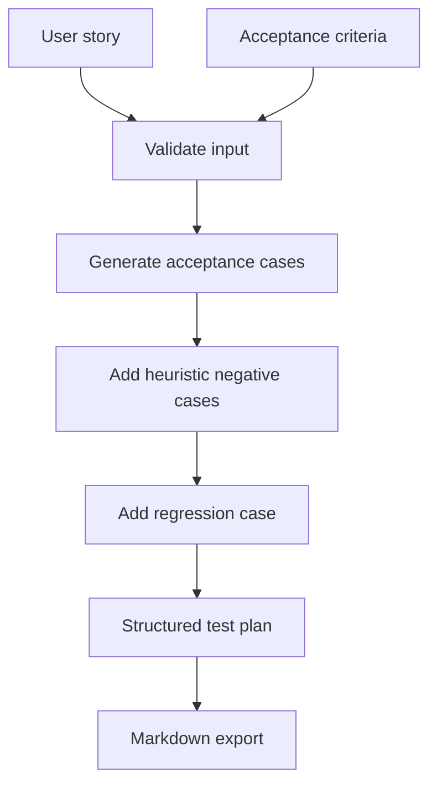

# AI Automated QA Test Generator

A requirements-to-checklist prototype that converts a user story and acceptance criteria into a structured set of acceptance, negative-validation, and regression test cases, with a Markdown export.

> **Scope:** The current implementation uses deterministic templates and keyword checks. It does not call an LLM, execute the application, or guarantee complete test coverage.

## Features

- Validates that a story and at least one non-empty acceptance criterion are provided.
- Creates a stable acceptance test ID for each criterion.
- Adds a negative-validation case for criteria containing common required/boundary terms.
- Adds a general regression case.
- Produces structured preconditions, steps, expected results, and priorities.
- Exports the test plan as Markdown.

## Generation flow



## Quick start

Requirements: Python 3.10+.

```bash
git clone https://github.com/HardikPaghdar/ai-automated-qa-test-generator.git
cd ai-automated-qa-test-generator
python -m venv .venv
source .venv/bin/activate
# Windows: .venv\Scripts\activate
```

Generate a test plan from the included password-reset story:

```bash
python - <<'PY'
import json
from app import generate_test_cases, to_markdown
with open("examples/story.json", encoding="utf-8") as f:
    sample = json.load(f)
result = generate_test_cases(sample["story"], sample["acceptance_criteria"])
print(to_markdown(result))
PY
```

## Test case types

| Type | Purpose |
|---|---|
| `acceptance` | One scenario for each supplied criterion |
| `negative` | A generic missing/malformed/boundary-value check for selected keyword matches |
| `regression` | A broad adjacent-flow regression reminder |

## Tests

```bash
python -m unittest discover -s tests -v
```

GitHub Actions runs the test suite on pushes and pull requests.

## Limitations and review

- The generator does not infer business rules beyond the supplied criteria.
- Negative-case generation is keyword-based and may be too broad or miss important edge cases.
- Expected results reuse the supplied acceptance criterion and should be refined into observable assertions.
- No browser, API, unit, or integration tests are executed.
- QA engineers should review test data, security cases, payment flows, and boundary conditions before relying on the plan.

## Project structure

- `app.py` — test-case generation and Markdown formatting
- `examples/story.json` — sample password-reset story
- `tests/test_app.py` — unit tests

## Related projects

- [AI Meeting Intelligence Assistant](https://github.com/HardikPaghdar/ai-meeting-intelligence-assistant)
- [Multi-Agent Software Engineer](https://github.com/HardikPaghdar/multi-agent-software-engineer)
- [More projects on my portfolio](https://hardikpaghdar.netlify.app/)
